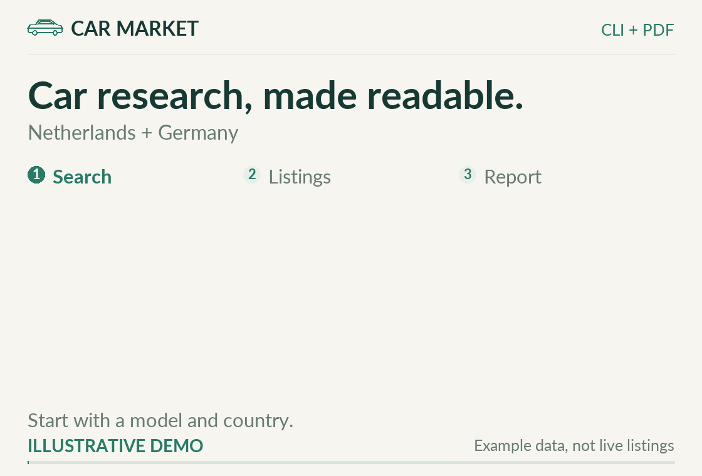
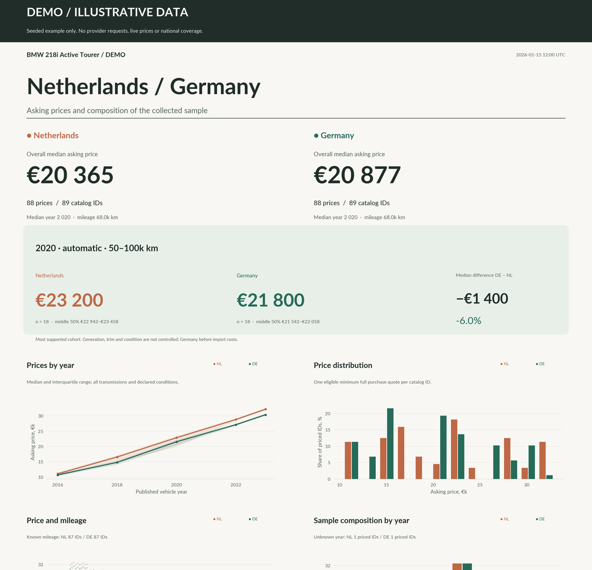

# Car Market

**Know what you are looking at before you buy.**

A research tool for car buyers in the Netherlands and Germany. Choose your
car, save the listings with their source evidence, and open an English report
that puts the asking prices in context.

<picture>
  <source media="(prefers-reduced-motion: reduce) and (max-width: 640px)" srcset="docs/media/car-market-workflow-mobile.png">
  <source media="(prefers-reduced-motion: reduce)" srcset="docs/media/car-market-workflow.png">
  <source media="(max-width: 640px)" srcset="docs/media/car-market-workflow-mobile.gif">
  
</picture>

[Start a search](#try-a-first-search) · [See the sample report](#what-the-report-looks-like) · [Sources and limits](docs/advanced.md#sources-and-coverage-limits)

The walkthrough uses an illustrated listing and synthetic report data.
[Static desktop illustration](docs/media/car-market-workflow.png) ·
[Static mobile illustration](docs/media/car-market-workflow-mobile.png).

## What you get

- Saved listings with source links, original dates and details that still
  need confirmation.
- Asking-price history and comparisons of age, mileage and transmission,
  with the sample sizes visible.
- English PDF and PNG reports you can open, inspect and share.

Run searches from a terminal with Docker. Open the reports as ordinary files.

## Try a first search

**Community Preview `0.3.0rc1`.** Tested with Docker on Linux (AMD64 and ARM64).
Docker Desktop on Windows and macOS is expected to work but has not been tested
yet; [reports are welcome](https://github.com/yarrrly/car-market-community/issues).

You need [Docker](https://docs.docker.com/get-started/get-docker/) with Compose v2.
On Windows, Docker Desktop must use Linux containers (the default). Get the
project with `git clone` or GitHub's **Code → Download ZIP**, and open a
terminal in the folder that contains `compose.yaml`:

```sh
git clone https://github.com/yarrrly/car-market-community.git
cd car-market-community
```

**macOS / Linux**

```sh
./start.sh research --make Toyota --model Corolla --country NL
./start.sh reports
```

**Windows PowerShell**

```powershell
.\start.ps1 research --make Toyota --model Corolla --country NL
.\start.ps1 reports
```

If Windows refuses to run a script from a downloaded ZIP, run
`Unblock-File .\start.ps1` once. That clears the download mark on that one
file and does not change your execution policy.

The first run downloads the ready-made image (about 2.4 GB). A search then
takes a couple of minutes: it reads up to 15 result pages and 50 listing pages,
saves everything in a Docker volume and writes an English report. `reports`
copies the report folder into `reports/` next to the launcher; open
`comparison-editorial.pdf` there.

Expect the result to say **partial** and the exit code to be **3**. That is
normal: a pass stops at its page and detail limits, and the saved sample is
still usable. Run `./start.sh research --resume` later to read more.

### Look at what was saved

```sh
./start.sh list       # matching listings with price, year and mileage
./start.sh vehicle 1a2b3c4d   # one car, using the ID shown by list
./start.sh status     # what the last pass read and what it skipped
./start.sh coverage   # how much of each site's own result count was read
./start.sh quality    # which fields are filled or contradictory
```

These commands print a short summary in a terminal. Add `--json` for the
complete machine-readable data. On Windows, use `.\start.ps1` the same way.

### Choose what to search

Without `--url`, the search opens AutoScout24's page for your make and model
(for example `/lst/toyota/corolla`). If AutoScout24 does not know that model
name, it falls back to the make's page and checks the model on each listing.

To search other sites, or to use a site's own filters, copy the search URL from
your browser and pass it with `--url`. Repeat `--url` for each site:

```sh
./start.sh research --make Toyota --model Corolla --country NL \
  --url "https://www.autoscout24.nl/lst/toyota/corolla?fregfrom=2019" \
  --url "https://www.marktplaats.nl/l/auto-s/toyota/q/corolla/"
```

Useful filters: `--year-from 2019`, `--transmission automatic`, `--fuel hybrid`,
`--exclude Cross` (to leave out the Corolla Cross) and `--max-pages 30`.
`./start.sh research --help` lists them all, and `./start.sh sources` shows the
supported sites.

### Keep searches separate

Each search lives in its own Docker volume, named after the project. The
default project is `car-market`. For another model or country, pick a new
project name first and keep using it for that search:

```sh
export CAR_MARKET_PROJECT=yaris-nl          # PowerShell: $env:CAR_MARKET_PROJECT = "yaris-nl"
./start.sh research --make Toyota --model Yaris --country NL
./start.sh reports
```

More options: [one-command research guide](docs/research-quickstart.md),
[Advanced usage](docs/advanced.md) and [Reports](docs/reports.md).
To build the image from source instead of downloading it, see
[Install](docs/release-preview.md#build-the-image-yourself).

## Compare the Netherlands with Germany

Run the same search for each country under its own project name, then build
one report that compares them:

```sh
CAR_MARKET_PROJECT=corolla-nl ./start.sh research --make Toyota --model Corolla --country NL
CAR_MARKET_PROJECT=corolla-de ./start.sh research --make Toyota --model Corolla --country DE
CAR_MARKET_PROJECT=corolla-nl ./start.sh compare corolla-de --title "Toyota Corolla"
CAR_MARKET_PROJECT=corolla-nl ./start.sh reports
```

```powershell
$env:CAR_MARKET_PROJECT = "corolla-nl"; .\start.ps1 research --make Toyota --model Corolla --country NL
$env:CAR_MARKET_PROJECT = "corolla-de"; .\start.ps1 research --make Toyota --model Corolla --country DE
$env:CAR_MARKET_PROJECT = "corolla-nl"; .\start.ps1 compare corolla-de --title "Toyota Corolla"
.\start.ps1 reports
```

`compare` reads the other search's saved data without changing it. Both
searches must use the same make and model.

## What the report looks like

The example below comes from Car Market's report engine. It compares two
synthetic BMW 218i Active Tourer samples and includes charts, comparable
groups and missing fields. **Every number is illustrative.** It shows the
report format, rather than today's prices or the size of a national market.

[Open the nine-page sample PDF](docs/media/sample-report.pdf) ·
[View the full overview](docs/media/sample-report.png) ·
[How the example was made](docs/media/sample-report-notes.md)

[](docs/media/sample-report.pdf)

## Understand the results

| Term | What it means |
|---|---|
| Matches your search | The listing's own fields confirm the make, model, country and filters. |
| Needs confirmation | The model, country or a detail is not confirmed yet; a later pass may settle it. |
| Asking price | The published offer price, not a sale price. Financing and conditional prices are kept apart. |
| Partial | A page limit was reached or some pages or details could not be read. The saved sample is still usable. |

Source counts describe the exact source query. Several publications may refer
to one car. These counts do not establish the share of distinct cars for sale
in a country, and a low asking price alone does not establish a bargain.
Unknown fields remain unknown. Seeing an ad again does not renew an old price
confirmation.

Supported generic adapters are AutoScout24 NL/DE, Marktplaats NL, AutoTrack NL
and Gaspedaal NL. Availability and accepted country/model evidence vary by
source. Gaspedaal is discovery-only; additional details may remain pending.
The tool respects login, CAPTCHA and access refusals.
[Source contracts and limits](docs/advanced.md#sources-and-coverage-limits)
explain what each result can support.

## Keep watching your search

Monitoring is optional. The background collector repeats the full search every
6 hours and checks for new listings every 30 minutes, within the same page and
detail limits. For the default `car-market` project:

```sh
docker compose -p car-market up -d     # start in the background
./start.sh status                      # what it read and when
docker compose -p car-market stop      # stop; the data stays
```

If you chose another project, use that name instead of `car-market`.
**`docker compose down -v` deletes the search's data volume.** For backups,
upgrades and recovery, follow [Operations](docs/operations.md).

## Use it responsibly

Car Market reads public search and listing pages at a modest pace (about one
request every 1.5 seconds per site) and stops at login pages, CAPTCHAs and
access refusals instead of working around them. Marketplaces have their own
terms for automated access and reuse of their content; you are responsible for
following them. The project does not ship saved pages from these sites; see the
[fixture policy](docs/fixture-policy.md).

## Go further

[Advanced usage](docs/advanced.md) · [Reliability](docs/reliability.md) ·
[Compact exports](docs/compact-export.md) · [Architecture](docs/architecture.md)
· [Contributing](CONTRIBUTING.md)

Project code and documentation use the [MIT license](LICENSE). Bundled Lato
fonts retain their [SIL Open Font License](car_market/assets/fonts/OFL.txt).
Dependency licenses remain with their respective packages. The small
[illustration renderer](docs/media/render_workflow.py) uses the existing report
fonts and Pillow; [media notes](docs/media/README.md) explain its sample data,
static alternative and reproduction.
